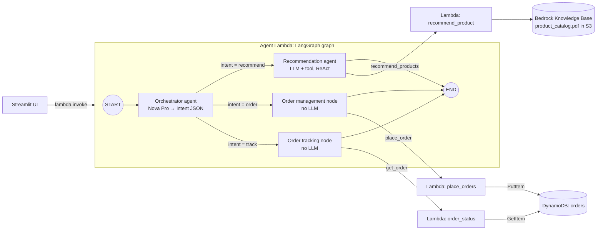

# E-Commerce-LangGraph-on-AWS

**AnyCart** is a multi-agent shopping assistant built with **LangGraph** and deployed on AWS.
One chat box handles three requests: product recommendations, placing orders and tracking
them. An orchestrator agent classifies the shopper's intent and routes it to the matching
worker. The workers call AWS Lambda tools backed by an Amazon Bedrock Knowledge Base and
Amazon DynamoDB.

Built while following the *Agentic AI on AWS* course (section "Build AnyCart Multi-Agent
E-Commerce").

## Architecture



| Component | Kind | What it does |
| --- | --- | --- |
| `orchestrator` | Agent (LLM) | Asks Amazon Nova Pro for `{"intent", "order_id", "product_id", "quantity"}` and writes them to graph state |
| `route_to_worker` | Conditional edge | Routes on `state["intent"]`; anything unrecognised goes to recommendation |
| `recommendation_agent` | Agent (LLM + tool) | `create_agent` ReAct loop over the `recommend_products` tool |
| `order_management_node` | Node (no LLM) | Calls `place_order` with `product_id` and `quantity` from state |
| `order_tracking_node` | Node (no LLM) | Calls `get_order` with `order_id` from state |

Graph state: `messages` (append reducer), `intent`, `product_id`, `quantity`, `order_id`.

## Repository layout

```text
Backend/
  product_catalog.pdf        # catalog indexed by the Bedrock Knowledge Base (12 products, IDs 01–12)
  product_catalog.docx       # editable source of the PDF
Tools-Lambda/                # the three tool Lambdas (plain Python, boto3 only)
  recommend_product/         # Bedrock Knowledge Base RetrieveAndGenerate
  place_orders/              # DynamoDB PutItem, returns a new UUID order_id
  order_status/              # DynamoDB GetItem by order_id
LangGraph/
  Local_Deployment/order_management/
    graph.py                 # graph run locally, with MemorySaver checkpointer
    requirements.txt         # graph + Streamlit dependencies
  Local_Deployment/SETUP_GUIDE.md
  Lambda_Deployment/order_management/
    graph.py                 # same graph + lambda_handler, stricter intent rules, no checkpointer
    Dockerfile               # Lambda container image (python:3.11 base)
    requirements.txt         # graph dependencies only
    SETUP_GUIDE.md
    ui/                      # Streamlit shop front + chat that invokes the agent Lambda
```

## Prerequisites

- Python 3.11 or 3.12
- AWS CLI configured (`aws configure`) for **us-east-1**. The region is hard-coded throughout.
- Amazon Bedrock model access enabled for **Amazon Nova Pro** (`amazon.nova-pro-v1:0`)
- Docker, for building the agent Lambda image

## AWS setup

Create the backend first, then the tools, then the agent. The names below are the ones the
code expects. If you change them, change the code too (see [Configuration](#configuration)).

1. **Product catalog Knowledge Base.** Upload `Backend/product_catalog.pdf` to an S3 bucket,
   create a Bedrock Knowledge Base over it, and sync it. Note the Knowledge Base ID.
2. **Orders table.** Create a DynamoDB table named `orders` with partition key
   `order_id` (String).
3. **Tool Lambdas.** Create three Python Lambda functions from `Tools-Lambda/`, named
   exactly `recommend_product`, `place_orders` and `order_status`. Their execution roles
   need:
   - `recommend_product`: `bedrock:RetrieveAndGenerate`, `bedrock:Retrieve`,
     `bedrock:InvokeModel`
   - `place_orders`: `dynamodb:PutItem` on `orders`
   - `order_status`: `dynamodb:GetItem` on `orders`

   Set your Knowledge Base ID in `recommend_product/lambda_function.py` first. The default
   3-second timeout is too short for the Knowledge Base call, so raise it.
4. **Agent Lambda.** Build and push the container image, then create a Lambda function
   from it (see [Deploy the agent to Lambda](#deploy-the-agent-to-lambda)). Its role needs
   `lambda:InvokeFunction` on the three tools and `bedrock:InvokeModel` for Nova Pro. Give it
   a generous timeout (tens of seconds), because one request can make several model calls.

## Run locally

The graph runs on your machine but still calls the deployed tool Lambdas and Bedrock, so
complete AWS setup steps 1–3 first.

```bash
cd LangGraph/Local_Deployment/order_management
python -m venv venv
source venv/bin/activate          # Windows: venv\Scripts\activate
pip install -r requirements.txt
python graph.py
```

`python graph.py` runs one hard-coded test message (tracking an order ID). Edit the message
at the bottom of the file to try other requests.

## Deploy the agent to Lambda

From `LangGraph/Lambda_Deployment/order_management`, with `<ACCOUNT_ID>` set to your AWS
account ID:

```bash
# Build a single-platform Docker-format image. Lambda rejects OCI image indexes.
docker build --provenance=false --output type=docker -t order-management .

aws ecr create-repository --repository-name order-management --region us-east-1
aws ecr get-login-password --region us-east-1 \
  | docker login --username AWS --password-stdin <ACCOUNT_ID>.dkr.ecr.us-east-1.amazonaws.com

docker tag order-management:latest <ACCOUNT_ID>.dkr.ecr.us-east-1.amazonaws.com/order-management:latest
docker push <ACCOUNT_ID>.dkr.ecr.us-east-1.amazonaws.com/order-management:latest
```

Create a Lambda function from that image (handler `graph.lambda_handler` is set in the
Dockerfile) and test it with:

```json
{ "message": "What type of shoes do you have?" }
```

It returns `{"response": "<assistant reply>"}`, or `{"error": "No message provided"}` when
the message is empty.

## Run the Streamlit UI

Set `LAMBDA_ARN` in `ui/streamlit_app.py` to your agent Lambda's ARN. The UI calls it with
`boto3`, so your local AWS credentials need `lambda:InvokeFunction` on it.

```bash
cd LangGraph/Lambda_Deployment/order_management
pip install -r requirements.txt streamlit==1.59.1
streamlit run ui/streamlit_app.py
```

Try the three intents in turn:

1. `What type of shoes do you have?`
2. `Please order product_id 05, quantity 2` (use an ID the recommendation reply showed you)
3. `What is the order status for order ID <order_id from step 2>?`

## Configuration

These values are hard-coded. Change them in these places:

| Value | Where |
| --- | --- |
| Region `us-east-1` | both `graph.py` files, `ui/streamlit_app.py`, `recommend_product` model ARN |
| Model `amazon.nova-pro-v1:0` | both `graph.py` files, `recommend_product/lambda_function.py` |
| Knowledge Base ID | `Tools-Lambda/recommend_product/lambda_function.py` |
| Tool Lambda names | `recommend_product`, `place_orders`, `order_status` in both `graph.py` files |
| DynamoDB table `orders` | `place_orders` and `order_status` Lambdas |
| Agent Lambda ARN | `LAMBDA_ARN` in `ui/streamlit_app.py` |

## Local vs Lambda graph

| | `Local_Deployment/graph.py` | `Lambda_Deployment/graph.py` |
| --- | --- | --- |
| Entry point | `graph.invoke(...)` under `__main__` | `lambda_handler(event, context)` |
| Memory | `MemorySaver` checkpointer, `thread_id="demo"` | none: every invocation is stateless |
| Intent prompt | basic field list | explicit rules: `order` only with a product_id, `track` only with an order_id, default to `recommend` |

## Known limitations

- **Two product catalogs.** The Knowledge Base catalog uses IDs `01`–`12`, while the UI's
  `ui/catalog.py` shows `SHOE-001`, `CLO-001` and so on. Orders must use the IDs that come
  back from the recommendation agent, not the ones on the UI cards.
- **No conversation memory on Lambda.** Follow-ups such as "order that one" don't work. The
  orchestrator sees only the current message, so give the product or order ID explicitly.
- **Brittle orchestrator parsing.** `json.loads(response.content)` fails if the model wraps
  its JSON in Markdown fences or adds any prose.
- **Unknown order IDs crash `order_status`.** It reads `response["Item"]` without checking
  whether the order exists.
- New orders are always written with status `Pending`. Nothing updates the status.
- `LangGraph/Local_Deployment/order_management` has no `ui/` folder. The UI lives only under
  `Lambda_Deployment`, and the two `SETUP_GUIDE.md` files are identical.
